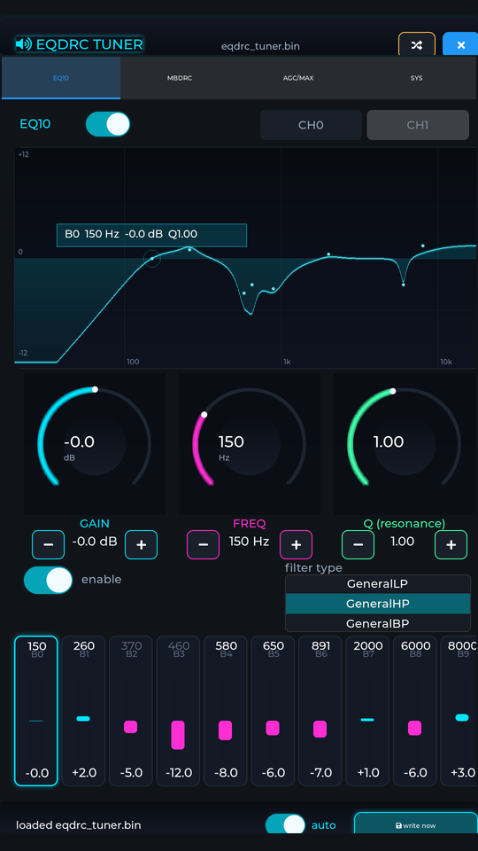
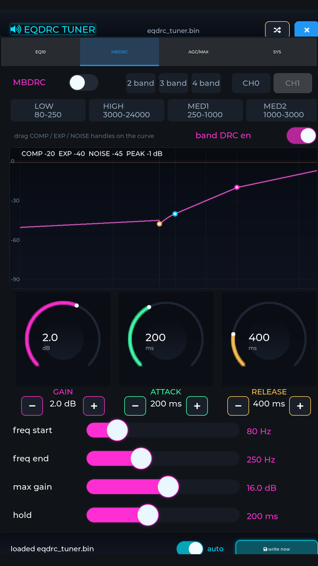
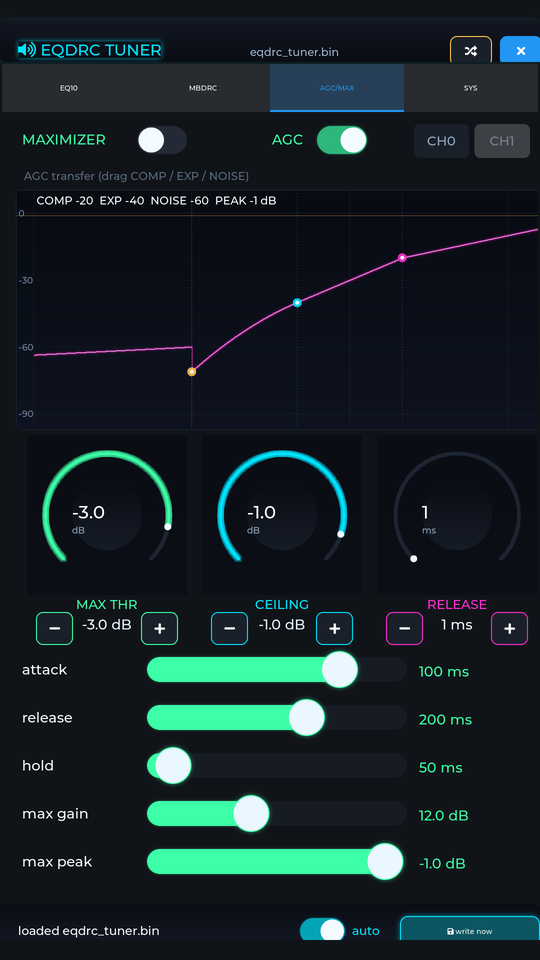
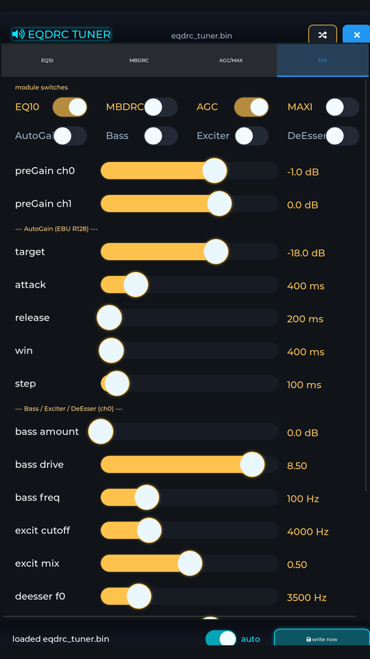

<!--
SPDX-License-Identifier: MIT
Copyright (c) 2026 piaozhiye <piaozhiye@gmail.com>
Original content of this file: MIT; see NOTICE for third-party scope.
-->
# eqdrc_tuner - EQDRC 板端实时调参 UI

[](LICENSE)

## 界面预览

| EQ10 | MBDRC |
|:---:|:---:|
|  |  |
| **AGC / MAXIMIZER** | **SYS** |
|  |  |

RK3576 + 1080x1920 DSI 触摸屏上运行；曲线节点/阈值手柄可直接拖拽，
旋钮支持粗拖 + [−]/[+] 步进微调，改动约 300ms 后自动写盘并热重载。

**顶栏 ⇄ 按钮一键切换两套界面**（选择持久化，重启记住）：
- **Studio Deck**（默认、主力界面）：曲线拖拽 + 旋钮 + 卡片 + DRC
  传递函数手柄，如上图；新功能只加在这里
- **Classic**（备选）：官方 PC 工具风格的表单布局（每参数一行水平
  滑条），熟悉 Rockchip Audio Effect Tool 的用户可直接上手；它是
  降级皮肤，功能不与 Studio Deck 对齐（无旋钮/传递曲线）

两套风格共用同一套参数 spec 表与约束强制，行为一致；仅布局不同。

在 RK3576 + 1080x1920 DSI 竖屏（goodix 触摸）上直接运行的 LVGL 调参工具：
改滑块 → 写参数 bin（原子 rename）→ ALSA `pcm_eqdrc` 插件 inotify 热重载，
**播放不中断、不重启、不依赖 PC**。等效于把官方 PC 端 Audio Effect Tool 的
调参闭环搬到了设备本体上。

```
UI 滑块 ──> /usr/share/rkaudio/*.bin (544 float, rename 原子覆盖)
                │ inotify IN_MOVED_TO
                ▼
        pcm_eqdrc 插件 AudioPost_SetPara ──> 正在播放的音频流即时生效
```

## 使用

```bash
# 播放任意音频走 eqdrc 链（asound.conf 已含 eqdrc_play/eqdrc_cap）
aplay -D eqdrc_play -f S16_LE -c 2 -r 48000 music.wav

# 板上运行（本板已配开机自启，独占面板）
LD_LIBRARY_PATH=/data/eqdrc_tuner/lib /data/eqdrc_tuner/eqdrc_tuner \
    [-p /path/to.bin] [-r 0|90|180|270]
```

界面四个 Tab：

| Tab | 内容 |
|-----|------|
| **EQ10** | 实时频响曲线（biquad 级联合成）+ 10 频段垂直增益滑条 + fc/Q/gain/滤波器类型/使能 |
| **MBDRC** | 分频段数(2/3/4)、四个频段(LOW/HIGH/MED1/MED2)的启止频率、压缩/扩张/噪声门/最大增益/峰值、attack/release/hold、band 使能 |
| **AGC/MAX** | Maximizer(thr/ceiling/release) 与 AGC 8 参数 |
| **SYS** | 8 个模块总开关、preGain、AutoGain(EBU R128)、Bass/Exciter/DeEsser、preset 加载/3 个 slot 保存 |

底栏：`auto` 开关（改动 300ms 后自动写盘）与 `write now` 手动写盘；状态栏
显示写入序号/时间。EQ10 / MBDRC / AGC-MAX 三页参数**按通道独立**：CH0/CH1 按钮切换
（`LINK=1` 时 CH1 禁用，跟 CH0 同参）；SYS 页的 Bass/Exciter/DeEsser
编辑 ch0，preGain 两行各对应一个通道。外部改 bin（adb push / 其他工具）
由 mtime 轮询检测并采纳（秒级粒度）。

## 许可与文件来源（先读 [NOTICE](NOTICE)）

本仓库混有三类来源的代码：

| 类别 | 文件 | 许可 |
|------|------|------|
| 本项目原创（UI/参数层/端口层/脚本） | `ui_main.c`、`eqdrc_para.*`、`lv_port_pc.*`、`lv_port_disp.*`、`mini_drm.*`、构建脚本 | **MIT**（见 [LICENSE](LICENSE)，© piaozhiye） |
| Rockchip SDK 材料（`app/lvgl_demo` 演示程序） | `evdev.*`、`key.*`、`lv_port_indev.*`、`lv_port_init.c`、`main.h`、`sys/`、`common/` | © Rockchip Electronics，依 **Rockchip SDK 许可条款**分发给 SDK 授权使用者，**不在本项目 MIT 范围内**（与 RK3308 Linux SDK V1.6.0 逐字节核对，仅 `lv_port_init.c` 有一处本地改动） |
| 第三方上游 | `include/lvgl/`（与上游 LVGL 8.4 逐字节一致，MIT）、`include/libdrm/`（内核 UAPI，MIT/X11） | 按上游许可，保留原版权声明 |

即：**客户可任意修改/使用本项目的 MIT 部分**；第 2 类文件的权利来自 Rockchip SDK 许可（客户作为 SDK 使用者通常已持有），第 3 类按上游许可。详见 [NOTICE](NOTICE)。

## 运行前提：EQDRC 运行组件（需向 Rockchip 获取）

本仓库**只包含调参 UI 本身**。设备上要跑通 EQDRC 链路，还需要以下
Rockchip 组件（随 **RK SDK** 提供给授权客户，
不在本仓库分发）：

| 设备端路径 | 组件 | 说明 |
|-----------|------|------|
| `/usr/lib/alsa-lib/libasound_module_pcm_eqdrc.so` | ALSA eqdrc 插件 | 把音频流串过 EQDRC、inotify 热重载参数 bin |
| `/usr/lib/librkaudio_effect_eqdrc.so` | EQDRC 算法库 | Rockchip 闭源算法（LGPL 不适用，SDK 授权分发） |
| `/usr/share/rkaudio/rkaudio_effect_eqdrc_*.bin` | 出厂参数 | 各采样率/场景 preset；默认 bin 也是本工具的默认编辑目标 |

拿到后按 `eqdrc-runtime/asound.conf-sample` 把 `eqdrc_cap/eqdrc_play`
两个 PCM 加进 `/etc/asound.conf`（**注意声卡号**，板卡升版后 es8388 可能
从 `hw:0,0` 变为 `hw:1,0`）。`deploy.sh` 假设这些组件已在板上——若
缺失，aplay 会报 `audio open error`。

## 参数 bin 布局（权威定义）

布局对照公开接口 `RK_AudioEffect_Interface.h` 与设备端
`librkaudio_effect_eqdrc.so` 的实际行为逐字段验证得到，完整定义见
`eqdrc_para.h`：

```
[0]fs [1]bit [2]link [3]chanum [4]ver
[10..17] 模块开关: AutoGain Bass Exciter DeEsser EQ10 MBDRC AGC Maximizer
[20..]  preGain ch0@20 ch1@25 (步长5)
[30]    AutoGain 5 参数(全局): target/attack/release/wins/steps
[60]    Bass ch0@60 ch1@70: amount/drive/blend/freq/floor_act/floor_freq
[80]    Exciter: even/dist/cutoff/mix (步长5)
[90]    DeEsser: f0/threshold (步长5)
[100]   EQ10: ch0 100..149 / ch1 150..199，每 band 5 个 [en type fc Q gain]
        type: 0=Parametric 1=LowShelf 2=HighShelf 3=LP 4=HP 5=BP 6=ButterLP 7=ButterHP
[200]   MBDRC: ch0 200..299 / ch1 300..399
        [0]=band数；band槽: LOW=+10 HIGH=+70 MED1=+30 MED2=+50 (槽长20)
        槽内12参数: f_start f_end gain drc_en comp_start expand_end
                    noise_thr max_gain max_peak attack release hold
        注意 band 顺序是 LOW,HIGH,MED1,MED2（GetPara switch 定义），MED2 仅 4 分频有效
[400]   Maximizer 段: ch0 400..419 / ch1 420..439
        [0..2] Maxi: thr/ceiling/release；[3..10] AGC: comp/expand/noise/maxgain/maxpeak/a/r/h
```

调参约束（算法库会校验）：`noise_thr < expand_end < compress_start`、
`(compress_start + max_gain) < max_peak`、Maximizer `max_thr < ceiling`。

## 界面（霓虹风格）

- EQ10 页为**自绘辉光频响曲线**（canvas 手写渲染器：背景渐变、 decade 网格、
  三层霓虹光晕 + 白热芯线、曲线下方能量填充、各 band 中心频点白色标记、
  匀速扫描线动画），底部频段按钮**直接显示每个 band 自定义的 fc 值**
- 四个 Tab 各有主题色：EQ 青 / MBDRC 品红 / AGC 薄荷绿 / SYS 琥珀
- 滑条/开关/按钮统一霓虹样式（发光旋钮、辉光描边）
- 面板玻璃会裁掉边缘数行像素，布局已预留 40px 上下安全边距

## 构建 / 部署

```bash
./build_aarch64.sh          # 交叉编译到 build_aarch64/eqdrc_tuner
./deploy.sh                 # 编译 + 推送(含新字体库 liblvgl) + 重启板子
./build_pc.sh               # PC SDL 仿真: ./eqdrc_tuner_pc (rpath 自带库路径)
```

依赖 aarch64 交叉工具链（`TOOLCHAIN=` 可覆盖，默认 `/opt/toolchains/gcc-arm-buildroot-aarch`）、
需自备 `lib/liblvgl.so`（LVGL 8.4，按 `include/lv_conf.h` 配置编译）与系统
libevdev / libfreetype。显示层支持 **rot=0 原生竖屏直写**与 90°/270° 转置
两种面板走线。

## 板端部署（本板已完成）

```
/data/eqdrc_tuner/eqdrc_tuner          # 主程序
/data/eqdrc_tuner/lib/liblvgl.so
/data/eqdrc_tuner/start_tuner.sh       # 开机延时启动
/etc/init.d/S99eqdrc_tuner             # 自启脚本（工位模式）
/usr/lib/alsa-lib/libasound_module_pcm_eqdrc.so
/usr/lib/librkaudio_effect_eqdrc.so
/usr/share/rkaudio/rkaudio_effect_eqdrc_*.bin
/etc/asound.conf                       # 追加了 eqdrc_cap/eqdrc_play
```

### 面板独占说明（重要）

本 DSI 面板**只支持冷启动直控**，两个坑都踩实了：

1. weston 运行过之后，任何用户态直接 DRM modeset（含 modetest 彩条、
   crtc disable/enable、DPMS Off/On）都无法重新点亮面板；
2. 调参器自身被 kill 再拉起（热重启）同样黑屏。**推送新版本后必须
   `adb reboot`**（`deploy.sh` 已封装）。
3. 额外注意：对 DSI 口做 DPMS Off→On 会把 VOP2 的 IOMMU 打挂
   （`MMU_DTE_ADDR is not functioning`，之后每帧
   `failed to attach dma mapping`），mini_drm 已移除相关 kick 逻辑。

因此调参工位模式**禁用了 weston 自启**（`chmod -x /etc/init.d/S49weston`），
由 `S99eqdrc_tuner` 在开机 8 秒后直接点亮面板。恢复桌面：

```bash
adb shell 'chmod +x /etc/init.d/S49weston
           chmod -x /etc/init.d/S99eqdrc_tuner
           kill $(pidof eqdrc_tuner); reboot'
```

调试截图：`kill -USR1 $(pidof eqdrc_tuner)` 落盘 `/tmp/drm_dump.raw`
（1080x1920 XRGB，pitch 1088 像素对齐）。
`EQT_TAB=<0..3>` 环境变量可指定启动时停留的 Tab。

界面风格的启动优先级：**`EQT_STYLE=1|2` 环境变量 > 顶栏 ⇄ 按钮的上次选择
（`slots/style.txt`）> 默认 Studio Deck**（`EQT_STYLE=1` 为 Classic 表单风格，
`=2` 为 Studio Deck；环境变量只在启动时生效，之后以 ⇄ 按钮的持久化选择为准）。

## 已验证

- `tests/test_eqdrc_para.c`：偏移表 static_assert 钉死（构建时强制运行），
  save/load 往返逐字节一致（含未用尾槽）、短读/超长文件拒绝且不污染
  调用方缓冲、失败路径无 `.new` 残留
- RK3576 板端：触摸改参 → bin 原子落盘 → 插件 inotify 热重载 →
  播放不中断（多轮实测）
- 写盘前统一执行约束检查（noise<expand<compress、
  compress+max_gain<max_peak、thr<ceiling），任何 UI 路径违反都会被钳位
